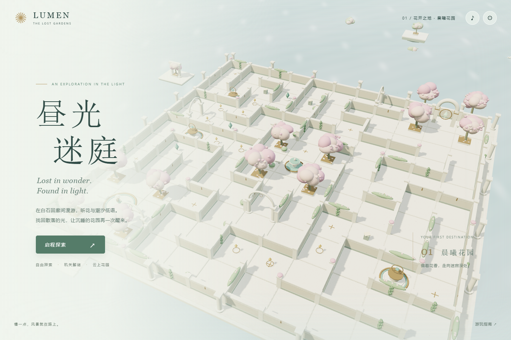

# 昼光迷庭 · LUMEN LABYRINTH

一场关于光、花园与归途的浅色系 3D 迷宫冒险。

**[点击开始游玩 →](https://yjj0339.github.io/lumen-labyrinth/)**



## 逐光而行

穿越三个各有风景的迷宫：晨曦花园、琉璃水庭与云上圣所。白石回廊、粉色花树、浅青水纹和金色观星环，构成一段可以慢慢探索的旅程。

- 三个章节，11 × 11、13 × 13 与 15 × 15 格确定性迷宫。
- 九座共鸣台：光轮校准、花语记忆、星灯联动。
- 27 枚光屑、九篇园丁手记与九枚记忆石。
- 探索地图、引路精灵、章节回访、完整结局与旅程纪念。
- 自动存档、三档画质、环境音乐与音效、PNG 留影。
- 桌面键鼠与手机摇杆操作；没有战斗或限时失败。

## 操作

| 操作 | 键位 |
| --- | --- |
| 移动 / 奔跑 | WASD、方向键 / Shift |
| 环顾 / 缩放 | 拖动画面 / 滚轮 |
| 互动 | E |
| 地图 / 手记 | M / J |
| 引路精灵 / 留影 | G / P |
| 暂停 / 返回 | Esc |

手机：左下摇杆移动，右下 E 互动；按住 ↑↑ 奔跑，拖动画面调整镜头。

## 本地与离线

下载本仓库后，可以直接打开 `昼光迷庭-直接打开.html`，无需安装或联网。也可以使用任意静态 HTTP 服务器从仓库根目录运行网站。

游戏资源全部包含在仓库中，不依赖外部 CDN、在线账号或付费素材。需要支持 WebGL 2 的现代浏览器。音乐在与页面互动后可通过右上角声音按钮开启。

进度保存在当前浏览器、当前网址的 localStorage 中。GitHub Pages、其他网站与离线文件的存档互不共享；请保留浏览器站点数据。

## 技术

使用 Three.js r179 和原生 JavaScript，无需构建。`maze.js` 负责地图与碰撞，`world.js` 负责场景，`game.js` 负责游戏流程。场景与音乐由程序生成。

执行地图测试（Node.js 22+）：

```sh
node --test tests/maze.test.mjs
```

GitHub Pages 从 `main` 分支根目录发布。更新页面资源并推送到 `main` 后会自动重新部署。

Three.js 使用 MIT 许可，完整许可见 [vendor/LICENSE](vendor/LICENSE)。
